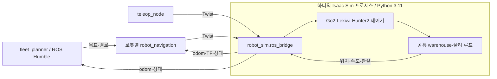

# ROS 2 workspace 확장 설계

2026-10-14에 작성한 전체 확장 설계다. 초기 Go2 workspace 구현 이후의 실제 실행 방법과 구현 범위는 [README.md](README.md)를 따른다.
Lekiwi 단독 및 공통 장면의 Go2+Lekiwi 동시 실행·독립 리셋과 Space 선택 PD waypoint를 추가 구현했다.
이 문서의 Hunter2·경로 계획·fleet는 후속 설계이며 아직 구현하지 않았다.

## NVIDIA ROS 설치 문서와의 호환성 확인

[Isaac Sim 5.1 ROS 설치 문서](https://docs.isaacsim.omniverse.nvidia.com/5.1.0/installation/install_ros.html#install-summary-steps)는
Ubuntu 22.04의 외부 Humble 노드를 Python 3.10으로 실행하고,
Isaac 내부 Humble 라이브러리를 Python 3.11로 사용해 DDS로 통신하는 구성을 명시한다.
따라서 이 설계의 외부 ROS workspace와 Isaac 프로세스 분리는 공식 문서의 방식에 맞는다.
문서에 제시된 `ROS_DISTRO=humble`, `RMW_IMPLEMENTATION=rmw_fastrtps_cpp`와
내장 라이브러리 경로 설정을 Isaac worker에 적용하고, 일반 Humble 환경은 외부 노드에 적용한다.

현재 설치는 Isaac Sim **5.0.0.0 / Python 3.11.16**이며 5.1 업그레이드는 수행하지 않았다.
설치된 5.0의 Humble/rclpy 라이브러리와 기존 cmd_vel/clock DDS 검증 결과를 확인했다.
5.1 문서의 설치 폴더 예시를 그대로 복사하지 않고 현재 Conda 설치의 extension 경로를 사용한다.
현재 Go2 실행은 내장 `rclpy`를 직접 사용하는 방식이며 `isaacsim.ros2.bridge`의
OmniGraph 확장 자동 시작은 끈 상태다. 공식 OmniGraph ROS 노드를 사용하려면
확장을 활성화하고 별도로 검사한다. 동일 토픽의 clock/state 중복 발행을 피하도록 소유자를 정한다.

`robot_interfaces`의 사용자 정의 타입을 Isaac 프로세스에서도 사용하게 되면
외부 Humble용 Python 3.10 빌드와 Isaac용 Python 3.11 빌드를 각각 준비한다.
소스 정의는 공유하되 두 빌드의 build/install/log 경로는 분리한다.
사용자 정의 fleet 타입을 외부 노드 사이에서만 사용하고 Isaac에는 표준 메시지를 보내는
초기 설계는 이 추가 빌드 없이 진행할 수 있다.

초기 Go2 구현과 외부 Humble 통신의 실제 검사 결과는 README.md와 `.runtime/ros2_workspace/`에서 관리한다.

목표는 하나의 warehouse에서 Go2·Lekiwi·Hunter2를 함께 시뮬레이션하고,
상위 플래너가 로봇별 navigation 노드를 통해 목표와 경로를 전달하는 구조다.
현재 Go2 보행 정책의 관측·관절 순서·액션 스케일·제어 주기는 유지한다.

## 패키지 구성

처음에는 `robot_sim`, `robot_control`, `robot_bringup` 세 패키지를 구현한다.
`robot_navigation`, `fleet_planner`, `robot_interfaces`는 해당 기능을 추가할 때 만든다.
모든 ROS 패키지는 `ros2_ws/src/` 바로 아래에 두고 중첩 패키지를 만들지 않는다.

```text
ros2_ws/
  README.md
  src/
    robot_sim/                      # ament_python
      package.xml
      setup.py
      setup.cfg
      resource/robot_sim
      robot_sim/
        __init__.py
        bootstrap.py                # Isaac Python에서 SimulationApp 생성
        runtime.py                  # 공통 물리·제어·상태 발행 루프
        scene.py                    # warehouse와 여러 articulation 생성
        robot_registry.py           # 로봇 종류 → 자산/제어기 생성 함수
        ros_bridge.py               # 인스턴스별 cmd_vel 수신·상태 발행
        clock.py                    # 공통 /clock 발행
        assets.py                   # 프로젝트 자산 경로·manifest 해석
      test/
    robot_control/                  # ament_python
      package.xml
      setup.py
      setup.cfg
      resource/robot_control
      robot_control/
        __init__.py
        commands.py                 # vx/vy/wz·수신 시각·명령 만료
        state.py                    # 로봇 상태와 이동 제약
        go2/
          controller.py             # 관측 48개 구성·정책 주기 관리
          policy.py                 # 기존 flat 정책 로더/추론
        lekiwi/
          controller.py             # 3개 바퀴의 속도 계산
        hunter2/
          controller.py             # 조향각·바퀴 속도 계산
        nodes/
          teleop_node.py            # 기존 ROS 키보드/상수 명령 송신
      config/
        go2.yaml
        lekiwi.yaml
        hunter2.yaml
      test/
    robot_bringup/                  # ament_python
      package.xml
      setup.py
      setup.cfg
      resource/robot_bringup
      robot_bringup/__init__.py
      launch/
        simulation.launch.py        # Isaac 실행·화면·ROS domain 설정
        teleop.launch.py            # 선택한 로봇에 키보드 연결
        navigation.launch.py        # navigation 단계에서 추가
        fleet.launch.py             # 상위 플래너 단계에서 추가
      config/
        warehouse.yaml             # 자산 root·물리 dt·카메라
        robots.yaml                # 인스턴스·namespace·초기 위치
      rviz/
        warehouse.rviz             # 상태/TF 발행 단계에서 추가
    robot_navigation/               # 후속 ament_python 패키지
      robot_navigation/
        goal_node.py                # 목표 수신·도착 판정·중단
        path_tracker.py             # 로봇 제약에 맞춘 경로 추종
        navrl_adapter.py            # NavRL 입력·출력 연결
      config/
    fleet_planner/                  # 후속 ament_python 패키지
      fleet_planner/
        planner_node.py             # 작업 배정·재계획
        robot_registry.py           # fleet의 상태/가용성 관리
        traffic.py                  # 공용 구간 예약·충돌 조정
      config/
    robot_interfaces/               # 후속 ament_cmake 패키지
      package.xml
      CMakeLists.txt
      msg/                          # 공통 상태/이동 제약이 필요할 때
      srv/                          # fleet 작업 관리가 필요할 때
      action/                       # 목표 실행·취소·피드백이 필요할 때
  build/                            # colcon 생성물, Git 제외
  install/                          # colcon 생성물, Git 제외
  log/                              # colcon 생성물, Git 제외
```

Python 패키지는 `package.xml`, `setup.py`, `setup.cfg`, resource marker와 Python 모듈을 갖춘다.
후속 패키지에도 같은 메타데이터를 추가한다. 순수 Python 노드는 `ament_python`을 사용하고,
사용자 정의 메시지·서비스·action의 생성은 별도 `ament_cmake` 패키지에서 처리한다.
[패키지 구조](https://github.com/ros2/ros2_documentation/blob/humble/source/Tutorials/Beginner-Client-Libraries/Creating-Your-First-ROS2-Package.rst),
[인터페이스 분리](https://github.com/ros2/ros2_documentation/blob/humble/source/Tutorials/Intermediate/Creating-an-Action.rst).

루트 `assets/`의 USD·URDF·mesh·정책·출처 manifest는 자산의 원본 위치로 유지한다.
launch가 `assets_root`를 명시적으로 전달하도록 하고 설치된 Python 파일의 `parents[n]`으로
저장소 위치를 추정하지 않는다. 대용량 자산을 ROS 패키지마다 복제하지 않는다.
초기 이식에서는 기존 `scenarios/` 설정을 재사용하고, 공통 장면 생성 로직을 `robot_sim/scene.py`로 분리한다.

## 프로세스와 Python 환경



일반 Humble launch·navigation·fleet 노드는 시스템 Python 3.10 환경에서 실행한다.
Isaac Sim과 로봇 제어 계산은 현재 `.conda/isaacsim-5.0`의 Python 3.11에서 실행한다.
NavRL은 요구하는 Torch/TensorDict 버전에 맞춘 별도의 Python 3.10 환경으로 실행할 수 있다.

`robot_bringup`은 `ExecuteProcess`로 명시적인 Isaac Python 경로를 실행한다.
Isaac 자식 프로세스에서는 ROS Python 경로·동적 라이브러리 경로를 정리하고
Isaac Sim 내장 Humble 라이브러리로 `rclpy`를 로드한다. 시스템 ROS overlay 전체를
Isaac 프로세스에 source하지 않는다. 자체 Python 모듈은 Isaac 환경에도 별도로 설치한다.
Go2의 Torch 버전은 navigation 환경의 설치 때문에 변경하지 않는다.

처음에는 Isaac 경계를 통과하는 메시지를 `Twist`, `Odometry`, `JointState`,
`TFMessage`, `Clock` 등 표준 타입으로 한정한다. 실제 bundled 라이브러리의 타입 지원은 구현 시 확인한다.
Python 3.10에서 생성한 사용자 정의 ROS 타입의 바이너리를 Python 3.11에서 import하지 않는다.
fleet용 사용자 정의 action은 우선 외부 Humble 노드 사이에서만 사용한다.
Isaac 쪽에서 사용자 정의 타입이 필요해지면 Python 3.11에 맞는 별도 타입 지원 빌드를 준비한다.

같은 실험의 모든 프로세스는 같은 `ROS_DOMAIN_ID`를 사용한다. 로봇 구분에는 namespace를 쓴다.
독립된 실험은 domain을 달리할 수 있다.
[ROS domain 설명](https://github.com/ros2/ros2_documentation/blob/humble/source/Concepts/Intermediate/About-Domain-ID.rst).

## 코드의 책임과 물리 루프

`robot_sim`이 SimulationApp, SimulationContext와 장면을 각각 하나씩 소유한다.
Go2·Lekiwi·Hunter2는 같은 장면에 서로 다른 articulation 이름으로 배치한다.
Isaac Lab의 `num_envs`를 로봇 수로 사용하는 대신, 하나의 환경 안에 여러 로봇 자산을 추가한다.

`robot_control`의 제어 계산 모듈은 `rclpy`와 launch를 import하지 않는다.
`nodes/teleop_node.py`만 ROS 노드이며, 제어기는 공통 물리 루프 안에서 호출되는 Python 객체다.
로봇별 controller가 앱·stage·환경을 새로 생성하거나 `sim.step()`을 호출하지 않는다.
초기에는 다음 정도의 작은 계약으로 시작한다.

```python
controller.set_command(command)       # 해당 로봇의 이동 제약 적용
controller.update(sim_time, dt)        # 필요한 주기에 관절 목표 갱신
controller.read_state()               # 위치·속도·관절·동작 상태
controller.reset(initial_state)       # 해당 로봇만 리셋
```

물리 dt는 현재 Go2 설정인 0.005초를 기준으로 한다. Go2 정책은 0.02초마다 실행하고
그 사이 관절 목표를 유지한다. 바퀴 로봇의 제어 주기는 설정에서 분리한다.
실행 순서는 ROS 최신 명령 수신 → 로봇별 제어 목표 갱신 → scene의 목표 기록 →
공통 물리 1스텝 → 상태 갱신 → 필요한 주기에 상태/clock 발행 → 화면 갱신이다.

`/clock`은 공통 시뮬레이터에서만 발행한다. 외부 플래너의 `use_sim_time`은 켠다.
한 로봇의 명령 만료·통신 해제·리셋이 다른 로봇의 물리 진행을 멈추거나 리셋하지 않게 한다.
명령 만료 검사는 기존처럼 벽시계의 monotonic 시간을 사용하고,
Go2에는 0 속도 보행 명령, 바퀴 로봇에는 정지 목표를 적용한다.

초기 teleop와 navigation은 로봇별로 한 입력원만 선택한다.
두 입력원을 함께 운용할 때는 우선순위와 명령 소유권을 가진 중재기를 추가한다.

## ROS 인터페이스

| 이름 | 타입/책임 | 소유자 |
|---|---|---|
| `/clock` | `rosgraph_msgs/Clock` | 공통 시뮬레이터 |
| `/<robot_id>/cmd_vel` | `geometry_msgs/Twist`, 몸체 좌표의 vx/vy/wz | teleop 또는 navigation → sim |
| `/<robot_id>/odom` | `nav_msgs/Odometry`, 시뮬레이터 실제 위치·속도 | sim |
| `/<robot_id>/joint_states` | `sensor_msgs/JointState` | sim |
| `/tf`, `/tf_static` | 로봇별 고유 frame ID의 변환 | sim 또는 로봇 description 노드 |
| `/waypoint/goal_pose` | 구현된 RViz 공통 `geometry_msgs/PoseStamped` 목표 | RViz → Space 선택 PD 노드 |
| `/<robot_id>/goal_pose` | 향후 로봇별 목표 인터페이스 | fleet → navigation |
| `/<robot_id>/navigate` | 후속 action, 실행·취소·피드백·결과 | navigation |
| `/fleet/...` | 후속 작업 요청·배정·fleet 상태 | fleet_planner |

예를 들어 `go2_0`, `lekiwi_0`, `hunter2_0`를 인스턴스 ID로 사용한다.
TF는 공유 `map` 아래에 `go2_0/odom`, `go2_0/base_link`처럼 고유한 frame ID를 사용한다.
namespace가 메시지 안의 frame 문자열까지 자동으로 바꾸지는 않으므로 명시적으로 설정한다.
초기 위치는 simulator ground truth로 발행하며 SLAM·상태 추정은 별도 단계로 추가할 수 있다.
단일 Go2 명령 `/unitree_go2/cmd_vel`의 이식은 explicit topic 설정으로 유지할 수 있다.

로봇별 이동 제약은 controller 설정과 navigation에서 함께 사용한다.
Go2의 보행 범위, Lekiwi의 전방향 바퀴 속도 한계, Hunter2의 조향·최소 회전반경을 구분한다.
Hunter2에 불가능한 횡이동이나 정지 상태의 제자리 회전 명령을 그대로 적용하지 않는다.
상위 플래너는 작업·목표·경로를 다루고, 바퀴 속도나 Go2 관절 액션을 직접 만들지 않는다.

## 설정 예시

아래는 제안하는 프로젝트 설정 스키마이며 현재 실행 가능한 ROS parameter 파일이 아니다.

```yaml
world:
  scenario: warehouse
  seed: 42
  physics_dt: 0.005
  assets_root: /path/to/project/assets
robots:
  - id: go2_0
    type: go2
    namespace: go2_0
    position: [0.0, 0.0, 0.4]
    yaw: 0.0
    controller_config: go2.yaml
  - id: lekiwi_0
    type: lekiwi
    namespace: lekiwi_0
    position: [2.0, 0.0, 0.3]
    yaw: 0.0
    controller_config: lekiwi.yaml
```

Lekiwi의 위치·높이는 예시이며 접촉 검사 후 확정한다. launch가 설정을 검증하고
절대 경로로 해석한 configuration을 Isaac bootstrap에 전달한다.
초기에는 데이터 파일 `robots.yaml`과 실제 ROS 노드 parameter YAML을 구분해서 관리한다.

## 기존 코드의 이식 위치

| 현재 파일 | 제안 위치/변경 |
|---|---|
| `control/go2/ros_bridge.py` | 환경 bootstrap → `robot_sim/bootstrap.py`; 명령 저장 → `robot_control/commands.py`; ROS I/O → `robot_sim/ros_bridge.py`; clock 분리 |
| `control/go2/ros_runtime.py` | 물리 루프 → `robot_sim/runtime.py`; Go2 관측/정책 처리 → `robot_control/go2/controller.py` |
| `control/go2/policy.py` | `robot_control/go2/policy.py`, 모델/체크포인트 계약 유지 |
| `scripts/go2/ros_command.py` | `robot_control/nodes/teleop_node.py`, 로봇 ID·topic parameter 제공 |
| `scripts/go2/ros.py` | `robot_bringup` launch와 Isaac bootstrap으로 기능 이식; 전환 중 기존 실행 경로 유지 |
| `scripts/visualization/` | 기존 로컬/WebRTC 표시·캐시·종료 처리 재사용 |
| `scenarios/` | 초기 설정 재사용; 여러 로봇 장면 조립을 `robot_sim/scene.py`로 분리 |
| `assets/` | 프로젝트 공통 자산 위치 유지, `assets_root`로 참조 |
| `navigation/` | 구현을 시작할 때 `robot_navigation`으로 통합 |

Go2의 `ManagerBasedRLEnv`를 로봇마다 생성하는 방법으로 확장하지 않는다.
공통 scene을 도입하면서 Go2 관측 계산과 리셋을 인스턴스 단위로 추출해야 한다.
이 부분이 폴더 이동보다 큰 변경이며 기존 보행의 회귀 검증 대상이다.

## 구현 순서와 완료 기준

1. 시스템 Humble/colcon 환경과 초기 세 패키지를 구성하고 launch가 Isaac Python을 올바르게 실행하는지 확인한다.
2. Go2만 새 구조로 실행한다. 현재 체크포인트·관측 48개·액션 12개·50Hz·명령 만료·clock 동작을 비교한다.
3. Lekiwi의 팔 자세를 고정하고 단독 주행을 연결한다. 전후·횡이동·회전·정지와 odom/TF를 확인한다.
4. 한 장면에서 Go2+Lekiwi를 실행한다. 명령 간섭 없음, 한 clock, 상호 충돌, 독립 정지/리셋을 확인한다.
5. 로봇별 목표점 추종과 fleet의 간단한 목표 배정을 추가한다. 도착·실패·취소가 필요한 시점에 action을 도입한다.
6. Hunter2의 주행 제어와 navigation 제약을 추가하고 세 로봇의 공동 실험으로 확장한다.

구현 후의 실행 명령은 다음 형태를 목표로 한다. 현재 사용 가능한 명령은 아니다.

```bash
cd /path/to/project/ros2_ws
source /opt/ros/humble/setup.bash
colcon build --symlink-install
source install/setup.bash
ros2 launch robot_bringup simulation.launch.py robots_file:=/path/to/robots.yaml
ros2 launch robot_bringup teleop.launch.py robot_id:=lekiwi_0
# navigation/fleet 구현 후
ros2 launch robot_bringup fleet.launch.py robots_file:=/path/to/robots.yaml
```

launch의 `isaac_python` argument는 프로젝트 Conda Python의 절대 경로로 지정한다.
시스템 launch 환경이 Isaac worker에 전달되는 환경을 정리하고, 종료 신호를 worker에 전달해
시뮬레이터 프로세스가 남지 않도록 기존 launcher의 동작을 유지한다.
